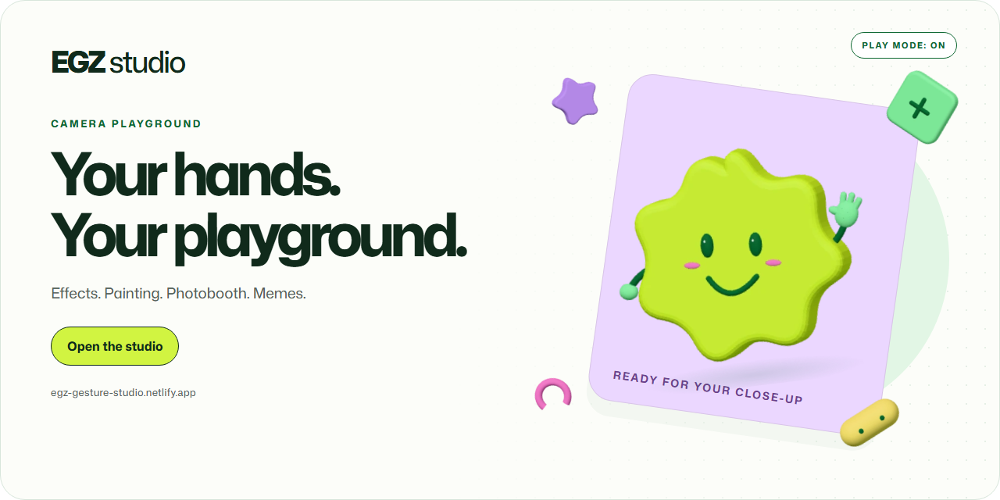
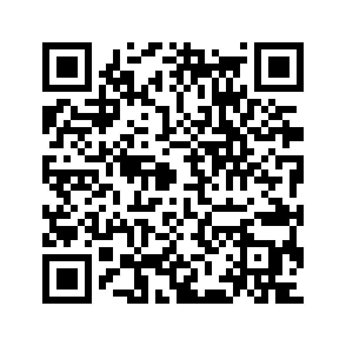
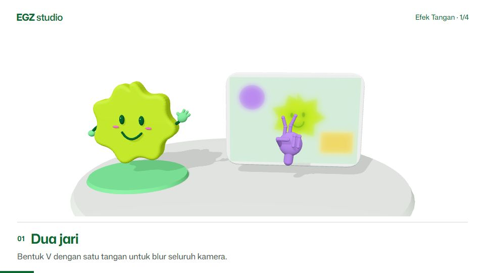
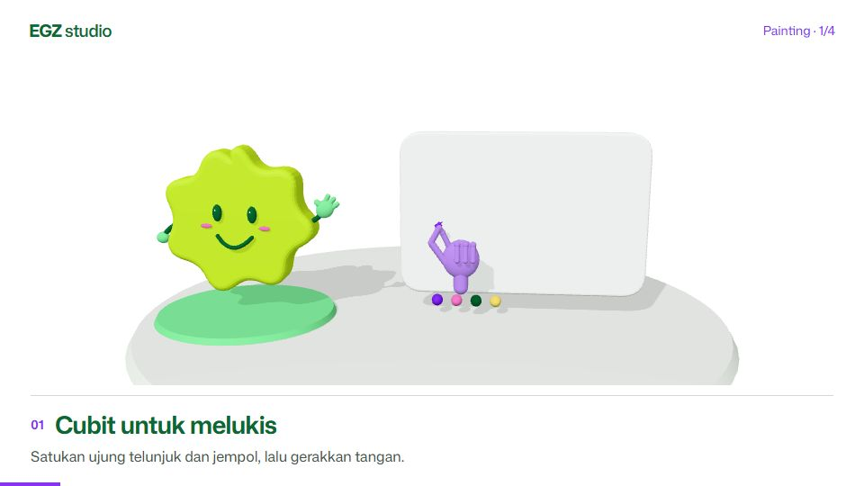
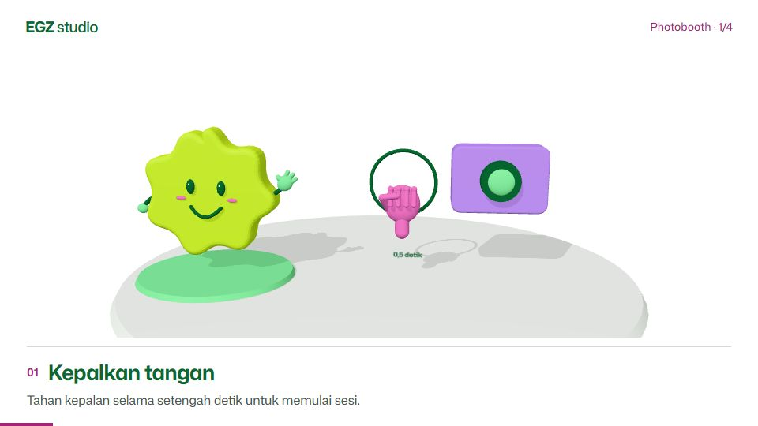
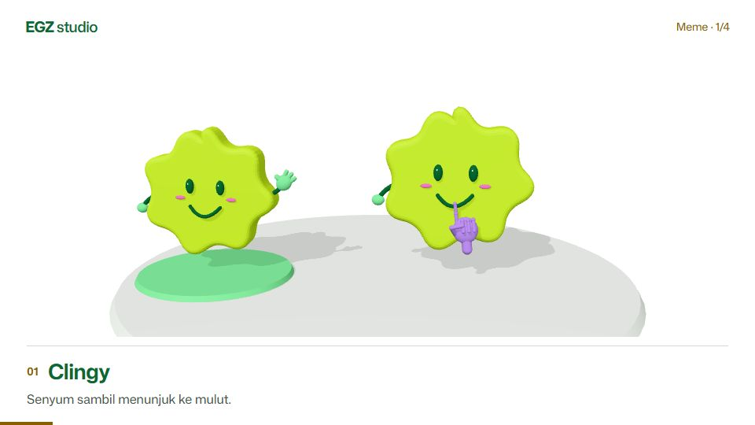

<a href="https://egz-gesture-studio.netlify.app"></a>

# EGZ studio

Play with effects, draw in the air, and make photobooth strips with your webcam.
Free to use, with no login or watermark.

[](https://github.com/EGYYFZA/hand-touch-design/actions/workflows/checks.yml)
[Website](https://egz-gesture-studio.netlify.app) · [User guide](docs/usage.md) · [Contributing](CONTRIBUTING.md) · [Security](SECURITY.md)

<table>
<tr>
<td>

### Try it in your browser

Open the studio, enable your camera, and choose a mode. Built-in tutorials show
the gestures; mouse, touch and keyboard controls are also available.

Best experienced on a laptop or desktop. The layout adapts to smaller screens.
Camera processing and new photos stay in your browser. On shared devices,
download your photos and delete them from the local gallery before leaving.

**[Open EGZ studio](https://egz-gesture-studio.netlify.app)**

</td>
<td align="center" width="220">
<a href="https://egz-gesture-studio.netlify.app"></a><br>
<sub>Scan to open the studio</sub>
</td>
</tr>
</table>

## Four ways to play

| Hand effects | Painting |
| :-- | :-- |
| <br>Shape blur and mosaic areas with your hands. | <br>Pinch to draw. Use your palm to erase. |
| **Photobooth** | **Memes** |
| <br>Take three shots in a playful frame. Preview, download or print. | <br>Trigger stickers with expressions and gestures. |

## Run locally

Requires **Node.js 22+** and a browser with webcam support.

```sh
git clone https://github.com/EGYYFZA/hand-touch-design.git
cd hand-touch-design
npm ci --ignore-scripts
npm run dev
```

Open **http://127.0.0.1:4173**. The browser studio runs without backend setup.
On PowerShell, use `npm.cmd` if script execution is restricted.

## Project guide

- [Using the studio](docs/usage.md) — gestures, shortcuts and photo storage.
- [Development](docs/development.md) — folder map, checks and media tooling.
- [Python desktop app](docs/desktop.md) — setup and desktop controls.
- [Deployment](docs/deployment.md) — hosting your own instance.
- [Security policy](SECURITY.md) — private reporting and data handling.

Bug reports and focused pull requests are welcome. See [CONTRIBUTING.md](CONTRIBUTING.md).

## License

Code and original EGZ artwork are released under the [MIT License](LICENSE).
Libraries, model weights, fonts and supplied meme images have separate terms;
check [THIRD_PARTY.md](THIRD_PARTY.md) before reusing them.

Maintained by [EGYYFZA](https://github.com/EGYYFZA).
