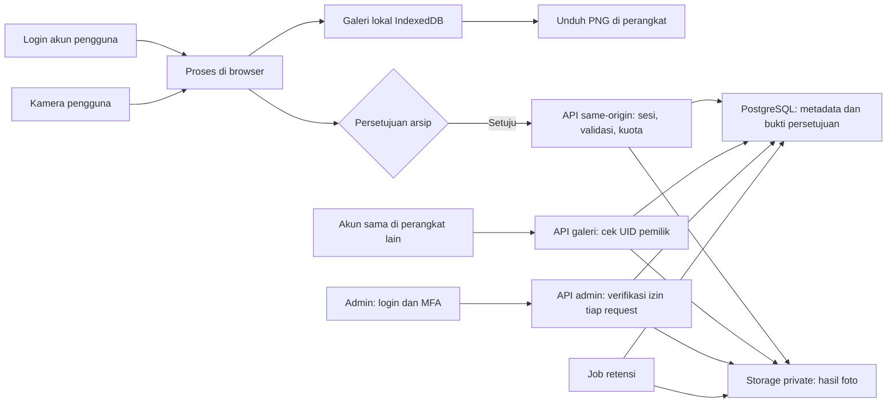

# Backend publik, privasi foto, dan arsip admin

Tanggal: 2026-10-29 (Asia/Jakarta). Rancangan awal kini sudah diimplementasikan
untuk backend lokal yang terhubung ke Supabase. **Pendaftaran umum dan hosting
web produksi belum dibuka.** Status aktual dan bukti pengujian ada di
[laporan integrasi](backend-integration-status.md); kontrak di bawah tetap
menjelaskan rancangan konseptual, termasuk beberapa pengembangan lanjutan.

Pilihan pemilik telah dikonfirmasi: login akun dan akses foto lintas perangkat;
salinan admin hanya setelah persetujuan; semua salinan cloud pengguna dan admin
memiliki retensi 30 hari; foto lokal/unduhan tetap dikelola pengguna. Dua ADR
boleh dicatat sebagai proposed. Kebijakan ini telah dikonfirmasi pemilik, tetapi
retensi 30 hari sudah aktif di Supabase. Pendaftaran publik masih menunggu
SMTP Resend/domain dan konfigurasi produksi.

## Hasil riset dan keputusan yang disarankan

Rekomendasi: pertahankan frontend statis Vercel, pemrosesan kamera di perangkat,
IndexedDB untuk galeri lokal, dan tambahkan Supabase PostgreSQL + Storage privat
untuk galeri akun dan arsip admin. Ini penilaian kecocokan arsitektur, bukan klaim paling murah.
Foto disimpan sebagai object; database hanya menyimpan metadata, persetujuan,
kepemilikan, status unggah, dan retensi. Tidak perlu mengirim video langsung
atau landmark wajah/tangan ke backend.

| Pilihan | Kesesuaian dan konsekuensi |
| --- | --- |
| Supabase | Pilihan awal: Auth, PostgreSQL, kebijakan RLS, dan Storage tersedia dalam satu ekosistem. Kebijakan harus diuji; adanya akun tidak otomatis mengisolasi data. |
| Firebase | Alternatif jika tim sudah menggunakannya. Cloud Storage memakai Security Rules; kini memerlukan paket Blaze. Bukan pilihan awal untuk repo yang belum memakai Firebase. |
| Cloudflare R2 + Workers | Kandidat bila kapasitas dan distribusi arsip besar. R2 tidak menagih egress bandwidth pada dokumentasi yang ditinjau, tetapi identitas, database, admin, dan pembatasan unggah perlu dirakit. |

Dasar teknis: [Supabase Storage access control](https://supabase.com/docs/guides/storage/security/access-control),
[Firebase Storage Security](https://firebase.google.com/docs/storage/security),
[Firebase billing changes](https://firebase.google.com/docs/storage/faqs-storage-changes-announced-sept-2024),
[R2 pricing](https://developers.cloudflare.com/r2/pricing/).

## Apa yang sudah berubah dan apa yang masih berupa proposal

Sudah diimplementasikan lokal: foto tersimpan di IndexedDB; dapat dipulihkan
setelah reload; maksimum 12 hasil dan 40 MiB; gagal simpan tetap dapat diunduh
dari memori tab; hapus menunggu transaksi penyimpanan berhasil. Kamera/pelacakan
memiliki profil desktop dan ringan. Build hanya menerbitkan daftar berkas publik.

Proyek Supabase `egz-gesture-studio` sudah dibuat di Singapore pada paket Free,
berstatus Healthy saat diperiksa, dengan bucket `photo-archive` private (PNG,
batas 3 MB). Automatic RLS diaktifkan dan auto-exposure tabel baru dinonaktifkan
saat pembuatan. Rincian: [status setup Supabase](supabase-setup.md).

Sesi akun, consent, upload tervalidasi, galeri owner/admin dengan MFA, hapus cloud,
serta scheduler retensi sudah diimplementasikan dan diuji. Migration 001–003
sudah diterapkan. Browser tetap memakai `connect-src 'self'` karena komunikasi
cloud melewati BFF. Implementasi memakai tabel berawalan `egz_` dan endpoint
`/api/studio?action=…`, bukan nama route konseptual persis pada tabel di bawah.
Ekspor ZIP massal belum termasuk implementasi ini; admin dapat membuka dan
mengunduh foto satu per satu. SMTP publik, akun/TOTP pribadi pemilik, dan
deployment web produksi belum diselesaikan.

## Batas identitas yang perlu dipahami

Pada mode akun, cache IndexedDB sudah ditandai UID dan dibersihkan saat logout,
pergantian akun, atau sesi berakhir. Galeri cloud memakai UID yang sama untuk
akses lintas perangkat. Mode demo eksplisit tetap terpisah per origin/profil
browser dan tidak mengautentikasi orang yang memakai profil bersama. Foto demo
tanpa owner tidak otomatis dimasukkan ke akun yang baru login. Domain preview
dan produksi tetap mempunyai cache lokal terpisah. Jangan menggunakan fingerprint perangkat atau pengenalan wajah untuk
menebak pemilik. IndexedDB mendukung data terstruktur termasuk Blob, tetapi
penyimpanan lokal bukan pengganti salinan berkas yang diunduh.
[MDN IndexedDB](https://developer.mozilla.org/en-US/docs/Web/API/IndexedDB_API).

Browser dapat menolak atau menghapus penyimpanan; meminta persistensi pun tidak
selalu dikabulkan. Penghapusan data situs dan mode privat dapat menghilangkan
hasil. Tindakan Unduh PNG tetap diperlukan untuk berkas milik pengguna.
[MDN persistent storage](https://developer.mozilla.org/en-US/docs/Web/API/StorageManager/persist).

Pemisahan berdasarkan sesi/perangkat juga bukan verifikasi bahwa orang yang
muncul di foto adalah pemilik akun. Foto dapat memuat orang di latar belakang.

## Alur data yang diusulkan

Pengguna tidak diberi endpoint daftar seluruh arsip. Galeri akun membaca cache
lokal miliknya dan daftar cloud yang dibatasi UID pemilik oleh API serta RLS.
Akun yang sama boleh membuka hasilnya di perangkat lain sesuai pilihan pemilik.
Kegagalan cloud tidak membatalkan foto lokal; foto belum terunggah belum bisa
dibuka dari perangkat lain. Logout pada perangkat bersama membersihkan cache,
dan sesi kedaluwarsa menyembunyikan galeri sampai login ulang.
Admin melihat foto yang berhasil diunggah dan disetujui; koneksi terputus,
browser ditutup, penolakan persetujuan, atau kuota berarti sebagian hasil tidak
akan masuk arsip. Tidak bisa menjamin semua jepretan sampai ke admin.

Persetujuan adalah opt-in sesuai pilihan pemilik; tanpa persetujuan, foto tetap
lokal dan tidak disalin ke admin atau disinkronkan dengan desain satu object ini.
Tujuan penggunaan arsip, identitas/kontak pengelola, masa simpan, penarikan izin,
dan apakah foto akan dipublikasikan/dipakai melatih model harus dijelaskan
terpisah. Persetujuan arsip bukan izin publikasi atau pelatihan model.

## Identitas, sesi, dan hak akses

Gunakan Supabase Auth dengan akun permanen sebelum mengakses galeri cloud dan
unduh PNG. Kamera, efek, Painting, Photobooth, Meme, galeri tamu dan Print dapat
digunakan tanpa login, mengikuti koreksi pemilik pada 2026-10-29. Login dan
galeri cloud berada di dialog pada halaman studio. Implementasi memakai email/password dengan
konfirmasi email; provider OAuth boleh ditambahkan setelah konfigurasi. UID dari sesi yang
diverifikasi server menjadi pemilik, bukan email/path dari request. Aktifkan
CAPTCHA serta limit pendaftaran/login; UID baru bukan bukti perangkat baru.
Anonymous Auth dipertimbangkan tetapi tidak dipilih karena tidak memulihkan
identitas lintas perangkat seperti akun permanen.
[Supabase anonymous sign-in limitations](https://supabase.com/docs/guides/auth/auth-anonymous).

Gunakan API same-origin/BFF agar refresh token tidak diletakkan di JavaScript
browser. Cookie sesi acak `HttpOnly; Secure; SameSite=Lax`, TTL pendek dan
rotasi; mapping/hash sesi serta refresh token dilindungi di server. Pilihan Lax
mendukung callback OAuth; mutasi tetap harus memeriksa Origin dan token CSRF.
Tidak ada token pada URL, log, `localStorage`, atau bundle. Rate limit Auth yang
berbasis IP harus diperhitungkan saat request diteruskan BFF; jangan percaya
header IP kiriman klien. Sesi BFF, Origin/CSRF dan rate limit aplikasi sudah
diimplementasikan; proteksi CAPTCHA/provider untuk signup publik masih diperlukan.

Admin: login akun permanen (GitHub boleh), verifikasi MFA, dan UID yang secara
eksplisit dimasukkan operator ke tabel admin. Akun GitHub yang digunakan masuk
dashboard Supabase berbeda dari identitas admin aplikasi. Login GitHub saja
tidak memberi hak admin. Jangan mengandalkan username/email kiriman klien,
`user_metadata.role`, hidden button, atau nama route `/admin`.
Enforce `aal2` dan status admin pada server **serta kebijakan data**, setiap
request; cabut akses dengan menghapus membership dan membatalkan sesi.
[Supabase MFA](https://supabase.com/docs/guides/auth/auth-mfa).

| Aksi | Tanpa login | Akun A | Akun B terhadap foto A | Admin terverifikasi |
| --- | --- | --- | --- | --- |
| Galeri lokal versi publik | Ruang tamu per profil browser | Cache UID A setelah login eksplisit | Tolak di UI; cache dibersihkan saat pergantian akun | Tidak mendapat akses lokal jarak jauh |
| Upload arsip | Tolak | Hanya melalui API setelah izin/kuota | Tidak dapat menentukan UID A | Bukan jalur upload pengunjung |
| Baca/list foto cloud | Tolak | Hanya owner_id = UID A, termasuk lintas perangkat | Tolak | Izinkan arsip dengan consent aktif + membership + MFA |
| Status/minta hapus milik sendiri | Tolak | API memeriksa owner sesi | Tolak | Izinkan dan audit |
| Ubah membership admin | Tolak | Tolak | Tolak | Operator terpisah, bukan endpoint pengguna |

Owner-read cloud diperlukan sejak awal. Filter UI bukan pengaman: query metadata,
download Storage, dan pembuatan signed URL harus menolak UID pemilik berbeda.
Cache lokal pada browser bersama tetap tidak melindungi dari akses fisik/devtools;
logout/pembersihan dan keamanan profil OS tetap batas yang harus dijelaskan.

## Penyimpanan dan otorisasi data

Bucket `photo-archive` harus **private**. Public bucket memungkinkan pembacaan
oleh siapa pun yang memiliki URL; path UUID tidak menggantikan kontrol akses.
[Supabase bucket access model](https://supabase.com/docs/guides/storage/buckets/fundamentals).

Aktifkan RLS pada metadata. Untuk bucket ini, jangan berikan policy INSERT,
UPDATE, DELETE langsung kepada pengguna. SELECT metadata dan Storage hanya untuk
pemilik autentik atau admin terverifikasi, row ready, belum expired/deleted,
serta consent aktif untuk akses admin. Cocokkan object_path dengan row metadata;
path yang dapat ditebak tidak cukup. Server menerima gambar, memvalidasi, lalu
mengunggah menggunakan kredensial khusus di server. Pembacaan memakai JWT
pengguna/admin agar RLS tetap berlaku; admin memerlukan membership + MFA;
hindari service key untuk endpoint baca umum/admin. Policy scope harus
memeriksa `bucket_id`, bukan membuka seluruh `storage.objects`.

Kredensial server dapat melewati RLS. Karena itu endpoint upload wajib
menentukan `owner_id` dari sesi tervalidasi, bukan body request, dan cek izin
sebelum memakai kredensial tersebut. Storage yang dibuat service key tidak
otomatis memperoleh owner pengguna. Metadata `owner_id` yang ditulis server
menjadi sumber kepemilikan aplikasi, bukan asumsi bahwa nama folder sudah aman.
[Supabase ownership](https://supabase.com/docs/guides/storage/security/ownership),
[Supabase RLS](https://supabase.com/docs/guides/database/postgres/row-level-security).

Skema konseptual awal di bawah memakai nama ringkas. Implementasi aktual memakai
tabel berprefix `egz_` dan tiga migration pada `supabase/migrations/`; kontrak RPC
tercatat pada `supabase/README.md`.

| Tabel | Kolom utama dan batasan |
| --- | --- |
| `app_sessions` | hash token sesi unik, UID auth permanen, expired_at; server-only; secret/token refresh tidak terekspos Data API |
| `consents` | UUID, owner_id, versi pemberitahuan, granted_at server, revoked_at; immutable kecuali pencabutan |
| `photos` | UUID server, owner_id, consent_id, object_path unik, idempotency_key unik per owner, mode enum, bytes/dimensi, created_at server, expires_at, status |
| `upload_budgets` | UID + time window unik, reserved_bytes/count; transaksi atomik dan lock agar request paralel tidak melewati kuota |
| `admin_memberships` | auth UID unik, granted_at, revoked_at; mutasi hanya operator |
| `admin_audit_events` | actor UID, aksi, photo/job UUID, waktu, hasil; append-only server; tanpa isi foto/token/URL bertanda tangan |

FK consent-photo harus menjamin owner cocok; `expires_at` dan jumlah byte
ditetapkan server. Status: reserved → uploaded → ready, atau failed;
ready → deleting → deleted. Jangan tampilkan row reserved sebagai foto siap.
Database dan object storage bukan satu transaksi: buat kompensasi dan job
rekonsiliasi untuk upload tanpa row, row tanpa object, serta reservasi kedaluwarsa.

## Kontrak API yang diusulkan

| Endpoint | Perilaku wajib |
| --- | --- |
| `POST /api/auth/start` dan callback/verify | Login permanen, CAPTCHA/rate limit, PKCE/state bila OAuth; verifikasi sebelum cookie sesi; tidak menerima owner arbitrer |
| `POST /api/auth/logout` | Cabut sesi, hapus cookie; UI melepaskan object URL dan menghapus cache akun pada perangkat |
| `POST /api/consent` | Catat versi persetujuan dan waktu server; cek CSRF; default belum setuju |
| `POST /api/photos` | Sesi + consent aktif + CSRF; validasi/decode gambar; reservasi kuota atomik; idempotency; upload; status ready |
| `GET /api/photos?cursor=…` | UID sesi sebagai filter wajib, pagination; RLS menahan query lintas pemilik |
| `GET /api/photos/:id/content` | Owner atau admin terverifikasi; JWT dan RLS, proxy bytes, private/no-store |
| `GET /api/photos/:id/status` | Owner sesi atau admin; response minimal; owner lain mendapat hasil tidak mengungkap keberadaan |
| `DELETE /api/photos/:id` | Owner sesi atau admin; job Storage remove + metadata; idempoten; audit |
| `GET /api/admin/photos?cursor=…` | Admin + aal2, pagination dan cap ukuran halaman, filter terbatas |
| `GET /api/admin/photos/:id/content` | Admin + aal2, proxy bytes, `Cache-Control: private, no-store`; tidak cache CDN |
| `POST /api/admin/exports` | Admin + aal2, job ekspor terbatas, audit; hasil privat dan kedaluwarsa |
| Scheduler internal | Secret internal terpisah, tidak endpoint publik tanpa autentikasi; retensi, retry, rekonsiliasi |

Preview admin sebaiknya melalui proxy terautentikasi same-origin. Signed URL
bersifat kredensial yang bisa digunakan pemegangnya sampai kedaluwarsa;
gunakan hanya bila dibutuhkan dengan TTL pendek, tanpa log/analytics/tautan
publik. Prinsip itu juga berlaku untuk presigned R2.
[R2 presigned URL semantics](https://developers.cloudflare.com/r2/api/s3/presigned-urls/).

Target awal validasi **usulan**, perlu disesuaikan metrik: PNG saja; batas body
3 MiB, maksimum 16 megapixel dan sisi 8192 pixel; decode dan re-encode server
untuk membuang metadata/payload tambahan; tolak SVG, animasi, MIME palsu,
gambar korup, serta decompression bomb. Ukur hasil strip asli agar batas tidak
menolak hasil sah. Limit runtime/body Vercel harus diverifikasi sebelum
memilih angka produksi. Jangan gunakan direct signed upload untuk melewati
validasi tanpa karantina dan proses verifikasi sebelum `ready`.

Kuota awal **usulan**: 10 upload/menit, 100/hari per visitor, 300 MiB/hari per
visitor, ditambah limit IP/edge, global harian, dan tombol mematikan upload.
Gunakan counter atomik persisten; counter RAM fungsi serverless tidak memadai.
IP bukan identitas tunggal karena NAT; kombinasi limit mencegah satu lapisan
menjadi satu-satunya pengaman. Supabase Auth rate limits hanya salah satu
lapisan, bukan limit khusus upload aplikasi.
[Supabase Auth rate limits](https://supabase.com/docs/guides/auth/rate-limits).

## Persetujuan, retensi, penghapusan, dan kegagalan

Retensi seluruh salinan cloud: **30 hari untuk pengguna dan admin**, sudah
dikonfirmasi pemilik aplikasi. Gunakan satu object privat yang dapat dibaca
pemilik dan admin berizin dengan waktu kedaluwarsa yang sama. Usulan teknis:
`expires_at` = waktu unggah pertama berhasil menurut server + 30 × 24 jam;
membaca, mengunduh, atau retry idempoten tidak memperpanjang masa simpan.
API dan RLS harus menolak akses setelah kedaluwarsa meskipun job pembersihan
belum selesai. Job menghapus object, thumbnail, dan ekspor cloud terkait;
keterlambatan pembersihan dipantau. Jangan otomatis mengunggah ulang foto lokal
yang masa simpan cloud-nya sudah habis.
Lokal tidak otomatis dihapus setelah 30 hari; pengguna mengelolanya sendiri.
Hapus lokal tidak boleh diam-diam dipresentasikan sebagai penghapusan arsip:
UI perlu tindakan terpisah dan status penghapusan cloud.

Retensi dijalankan job yang memanggil Storage API `remove()` untuk file dan
thumbnail; baru tandai row deleted setelah hasil terkonfirmasi. SQL DELETE pada
`storage.objects` hanya menghapus metadata dan dapat meninggalkan file fisik.
Retry kegagalan, audit, dan alarm backlog wajib dirancang.
[Supabase delete objects](https://supabase.com/docs/guides/storage/management/delete-objects).

Jangan melakukan FK cascade dari penghapusan user yang menghilangkan path
sebelum file dibersihkan. Atur pemusnahan ekspor sementara dan akses setelah
consent dicabut; pisahkan kebijakan backup/provider yang belum diverifikasi.
Jangan menjanjikan pemusnahan seluruh backup pada detik yang sama.

Outbox lokal untuk retry upload harus memiliki status per foto, consent versi,
batas retry/backoff, dan tombol batal; batalkan saat consent dicabut. Jangan
mengunggah foto lama secara retroaktif setelah pengguna baru setuju kecuali
pengguna memang memilihnya. Setelah storage browser dihapus, akun permanen
dapat login ulang dan membaca foto cloud yang belum kedaluwarsa; foto yang belum
terunggah hanya bisa dipulihkan dari unduhan/cadangan pengguna sendiri.

## Perangkat dan deployment

Web tetap desktop-first. Profil desktop memakai preferensi 1280×720/30 FPS,
frame inferensi lebar 640, interval minimal 50 ms. Profil ringan memakai
960×540/24 FPS, inferensi 480, interval 100 ms. Ini preferensi/batas, bukan
jaminan hardware. Sentuh/mouse/keyboard tetap jalur alternatif gesture.
Panel pada layar pendek dapat scroll sendiri tanpa scroll halaman utama.
Kamera membutuhkan secure context dan izin eksplisit.
[MDN getUserMedia](https://developer.mozilla.org/en-US/docs/Web/API/MediaDevices/getUserMedia),
[MDN createImageBitmap resizing](https://developer.mozilla.org/en-US/docs/Web/API/Window/createImageBitmap).

Uji fisik Windows Chrome/Edge, macOS Safari, Android Chrome, dan iOS Safari
masih diperlukan untuk orientasi, memory pressure, izin kamera, worker/WASM,
dan hasil download. Emulasi viewport Chromium tidak membuktikan dukungan iOS.

GitHub digunakan untuk source dan CI; Supabase menyimpan data, bukan GitHub.
Masuk Supabase dengan akun GitHub milik pemilik dan hubungkan integrasi
Supabase/GitHub bila ingin konfigurasi melalui sesi ini. Jangan kirim password,
PAT, service role key, atau database password di chat. Region dekat pengguna
Indonesia perlu dipilih setelah meninjau ketersediaan/ketentuan proyek.
Pisahkan development/preview/production dan cookie-domain; gunakan data sintetis
di preview. Kredensial produksi disimpan di environment server, bukan build web.

Tahap implementasi berikutnya:

1. Gunakan pilihan akun permanen, consent opt-in, serta seluruh cloud 30 hari;
   finalkan tujuan arsip, budget, domain, serta UID admin;
   gunakan proyek `chznehpvkuuooclyjhqg` yang sudah dibuat dan siapkan integrasi server.
2. Buat migration reviewed untuk metadata, admin membership, bucket private,
   RLS, fungsi kuota, dan job rekonsiliasi; jalankan di environment pengujian.
3. Implementasikan BFF, consent UI, outbox, status upload, admin MFA/gallery,
   audit, retensi, dan penghapusan; jangan mengaktifkan upload parsial.
4. Uji matrix otorisasi A/B/admin langsung via HTTP/Storage API, bukan hanya UI;
   uji pemalsuan UID, CSRF, role escalation, replay, kuota paralel, revoke,
   object orphan, signed URL leak, dan gagal retensi.
5. Ukur PNG/strip dan trafik; uji perangkat fisik; baru deploy dan jalankan
   smoke test produksi memakai foto sintetis.

Model kapasitas: foto/hari × ukuran rata-rata × hari simpan. Ilustrasi 1.000 ×
2 MB × 30 ≈ 60 GB steady state, sebelum thumbnail/ekspor/backup. Biaya juga
mencakup operasi, egress/download admin, compute, auth, dan job; belum ada
estimasi tagihan karena volume dan paket belum diketahui.

## Architecture Decision Records

Pemilik sudah menyetujui pencatatan sebagai **proposed**, termasuk penyesuaian
pilihan akun, consent, dan retensi. Ini persetujuan pencatatan; bukan klaim
backend telah diimplementasikan atau keputusan berstatus accepted.

- [ADR-0001: cache lokal dan perangkat adaptif](adr/0001-local-cache-and-adaptive-devices.md).
- [ADR-0002: akun, galeri privat, dan arsip admin Supabase](adr/0002-supabase-account-photo-archive.md).
- [Index ADR](adr/README.md) dan [template](adr/template.md).

## Metode dan batas keyakinan

Riset meninjau kode repo dan dokumentasi primer Supabase, MDN, Firebase, serta
Cloudflare. Firecrawl/Exa yang disebut skill tidak tersedia pada sesi ini;
digunakan penelusuran web bawaan dan satu agen riset paralel sesuai workflow
skill deep-research. Semua rujukan inline menunjuk dokumen resmi.

Keyakinan tinggi untuk perilaku private bucket, batas Auth anonim, ownership/RLS,
IndexedDB, dan Storage deletion yang didokumentasikan. Keyakinan sedang untuk
pilihan provider dan angka batas; volume, budget, serta kondisi perangkat fisik
belum diketahui. Proposal bukan audit
legal atau hasil penetration test pihak ketiga. Proyek Supabase dan hasil
pengujian backend sekarang dicatat pada laporan integrasi terkini.
